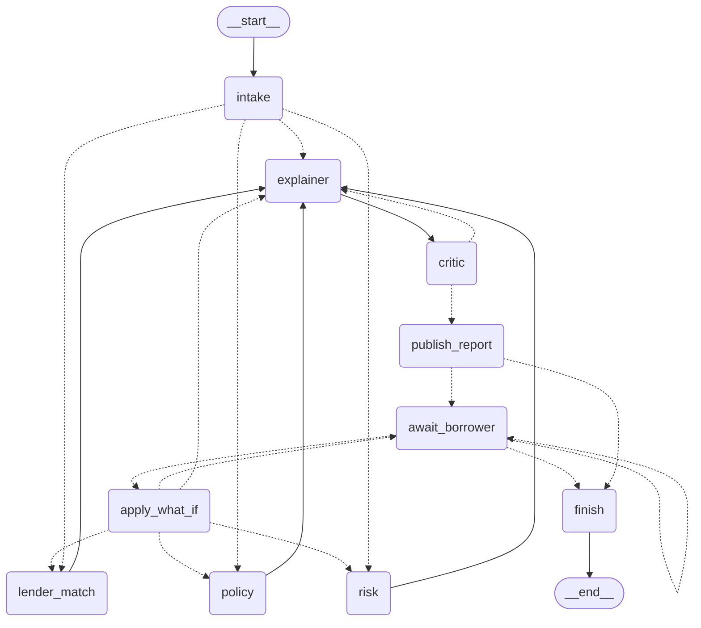

# Orchestrator

The Orchestrator runs the Navigator's loop with the borrower, using
[LangGraph](https://docs.langchain.com/oss/python/langgraph). It holds the case
file (every scenario the borrower has tried) and decides which agents to run,
when to ask the borrower, and when to stop.

**Status: skeleton with stand-in agents.** The loop, the parallel fan-out, the
Explainer–Critic review loop, the what-if loop and the "rerun only what changed"
routing all work. The agents themselves are deterministic placeholders, so no
LLM calls are made yet:

| Agent | File | Now | Next |
|---|---|---|---|
| Intake | `navigator/agents/intake.py` | validates a structured profile; asks for missing fields | LLM interview producing the same profile |
| Lender Match | `navigator/agents/lender_match.py` | **calls the real Lender Match service** when `LENDER_MATCH_URL` is set; stand-in otherwise | — |
| Risk | `navigator/agents/risk.py` | placeholder rules | call the Risk service (origination-time model from MRI) |
| Policy | `navigator/agents/policy.py` | placeholder citations | retrieval (RAG) over `policy/sources/` |
| Explainer | `navigator/agents/explainer.py` | template report | LLM report that answers the Critic's fixes |
| Critic | `navigator/agents/critic.py` | rule checks (no approve/deny language, citations, disclaimer) | rules + LLM review |

## The graph

Solid arrows always run; dashed arrows are routing decisions.



- **Parallel stage:** after Intake or a what-if, only the agents the change
  affects run, side by side (`navigator/routing.py`). The rest carry over
  from the previous scenario. The Explainer starts when they have all finished.
- **Review loop:** the Critic sends the draft back to the Explainer until it
  passes, at most `MAX_REVISIONS` times.
- **Borrower loop:** `await_borrower` pauses the graph (a LangGraph
  `interrupt`) with the report. The reply is a what-if, `done` or `give_up`.
  A session ends after `MAX_ROUNDS` scenarios at most.

## Setup (Windows, Git Bash)

```bash
cd orchestrator
py -3.11 -m venv .venv
source .venv/Scripts/activate      # Git Bash + Python 3.11: see the activate fix in lender_match/README.md
pip install -r requirements.in     # also installs ../shared and this package in editable mode
cp .env.example .env               # then edit .env
```

## Run it

```bash
python -m pytest                   # 9 tests, stand-in agents
python scripts/demo.py             # one session in the terminal: baseline, a what-if, done
python scripts/draw_graph.py       # writes docs/graph.mmd and docs/graph.png
langgraph dev                      # opens LangGraph Studio in the browser
```

For `demo.py` and Studio to use the real Lender Match, start it first in its
own terminal (`cd lender_match && python main.py`) and set
`LENDER_MATCH_URL=http://localhost:8000` in `.env`.

In Studio, the graph pauses at `await_borrower` and shows the report. Resume it
with a reply such as:

```json
{"action": "what_if", "label": "20% down, car paid off",
 "changes": {"purchase.down_payment": 90000, "finances.remove_debt": "car loan"}}
```

Studio needs a free LangSmith account. `LANGSMITH_TRACING=false` in `.env`
keeps run data on your machine.

## Settings (`.env`)

| Variable | Meaning |
|---|---|
| `ANTHROPIC_API_KEY` | for the LLM agents (not used by the stand-ins) |
| `LENDER_MATCH_URL` | Lender Match service; empty = stand-in |
| `ASSUMED_RATE_PCT` | **placeholder** rate for the payment and DTI estimate; replace with a current market rate |
| `MAX_ROUNDS`, `MAX_REVISIONS` | loop limits (defaults 6 and 3) |
| `APPROVAL_GREEN`, `APPROVAL_YELLOW` | **placeholder** thresholds for the approval traffic light (defaults 0.80 and 0.60) |
