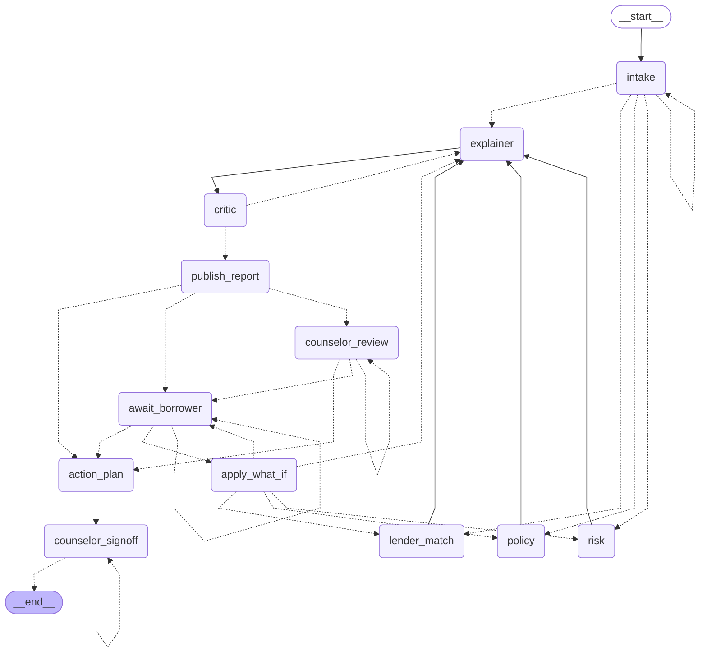

# Orchestrator

The Orchestrator runs the Navigator's loop with the borrower, using
[LangGraph](https://docs.langchain.com/oss/python/langgraph). It holds the case
file (every scenario the borrower has tried), decides which agents to run,
when to ask the borrower or a counselor, and when to stop.

The visual module design is in [`docs/modular-design.html`](docs/modular-design.html).

## Who owns what

| Box in the architecture | Package | Owner | Status |
|---|---|---|---|
| Orchestrator | `navigator/core/` + `graph.py` | Alekya | Rules: routing, specialist guard, stopping, escalation |
| Intake | `navigator/intake/` | Alekya | Interview loop; LLM reads free-text answers and what-ifs |
| Explainer | `navigator/explainer/` | Alekya | Signals and facts by code; LLM narrative, template fallback |
| Critic | `navigator/critic/` | Alekya | 7 rule checks + LLM review |
| Borrower + counselor | `navigator/human/` | Alekya | Report, what-if, counselor review and sign-off |
| Stop | `navigator/stop/` | Alekya | Action plan + counselor sign-off |
| Lender Match, Risk, Policy (gray) | `navigator/agents/` | Peter | Lender Match real; Risk and Policy stand-ins |
| Claude gateway | `navigator/llm/` | shared | `structured()` → Pydantic model or `LLMUnavailable` |

**Contract for a specialist (Peter's agents):** `fn(state) -> {"<name>": result}`
with a `LenderMatchResult`, `RiskResult` or `PolicyResult` from `mrn_shared`.
The graph wraps each in `core/specialists.guarded()`: an exception or a timeout
(`SPECIALIST_TIMEOUT_S`) becomes `source="unavailable"`, and the report says
*not assessed*. The session never stops because a specialist failed.

**LLM vs. rules (design D7):** the LLM reads the borrower's words and writes
prose. Code decides the signals, every number, the lender list, the citations
and every graph edge. Every LLM agent has a rule-based fallback, so the whole
loop runs with `NAVIGATOR_LLM=off`, which is how the tests run.

## The graph

Solid arrows always run; dashed arrows are routing decisions (`graph.py`).



- **Intake loop:** each run of `intake` is one turn; it asks up to 3 questions
  (`interrupt`) until the profile is complete and consistent, then fans out.
  After `MAX_INTAKE_TURNS` the questions go to a counselor.
- **Parallel stage:** only the specialists a change affects run
  (`core/routing.py`); the others carry over.
- **Review loop:** the Critic sends the draft back at most `MAX_REVISIONS` times.
  A report that still fails is **never shown to the borrower**: it goes to
  `counselor_review` (D15).
- **Escalation:** `publish_report` also sends a report to a counselor first when
  sustainability is red, approval is red with risk not assessed, Lender Match
  and Risk were both unavailable, or an LLM refused (`core/escalation.py`).
- **Borrower loop:** `await_borrower` pauses with the report. After rounds that
  change nothing material it offers to wrap up (`core/stopping.py`).
- **Stop:** done, give up or `MAX_ROUNDS` → `action_plan` → `counselor_signoff` → end.

## Replies at each pause

| Pause (`type`) | Who | Reply |
|---|---|---|
| `intake_questions` | borrower, or counselor after the turn cap | `{"purchase": {"target_state": "MD"}}` or free text |
| `report` | borrower | `{"action": "what_if", "changes": {"purchase.down_payment": 90000}}`, `{"action": "what_if", "text": "what if I put 20% down?"}`, add `"from_scenario": 0` to branch, `{"action": "done"}`, `{"action": "give_up"}` |
| `counselor_review` | counselor | `{"action": "approve"}`, `{"action": "annotate", "note": "..."}`, `{"action": "edit", "markdown": "...", "note": "..."}` |
| `counselor_signoff` | counselor | `{"action": "approve", "note": "..."}`, `{"action": "edit_plan", "steps": ["..."]}` |

What-ifs may change only the fields in `core/routing.EDITABLE_PATHS`.

## Setup

```bash
cd orchestrator
python -m venv .venv               # Python 3.11+ (Windows Git Bash: py -3.11 -m venv .venv)
source .venv/bin/activate          # Windows Git Bash: source .venv/Scripts/activate
pip install -r requirements.in     # also installs ../shared and this package in editable mode
cp .env.example .env               # then edit .env
```

## Run it

```bash
python -m pytest                   # 56 tests: no network, no LLM
python scripts/demo.py             # one session: PUD/condo question, baseline, a what-if, done, sign-off
python scripts/draw_graph.py       # writes docs/graph.mmd and docs/graph.png
langgraph dev                      # opens LangGraph Studio in the browser
```

For the real Lender Match, start it in its own terminal (`cd lender_match && python main.py`)
and set `LENDER_MATCH_URL=http://localhost:8000` in `.env`. Studio needs a free
LangSmith account; `LANGSMITH_TRACING=false` keeps run data on your machine.

## Settings

Every variable is listed with its default in [`.env.example`](.env.example) and read in
`navigator/config.py`. The ones to set before a demo: `ANTHROPIC_API_KEY`,
`ASSUMED_RATE_PCT` (placeholder until a current rate is chosen) and `LENDER_MATCH_URL`.
